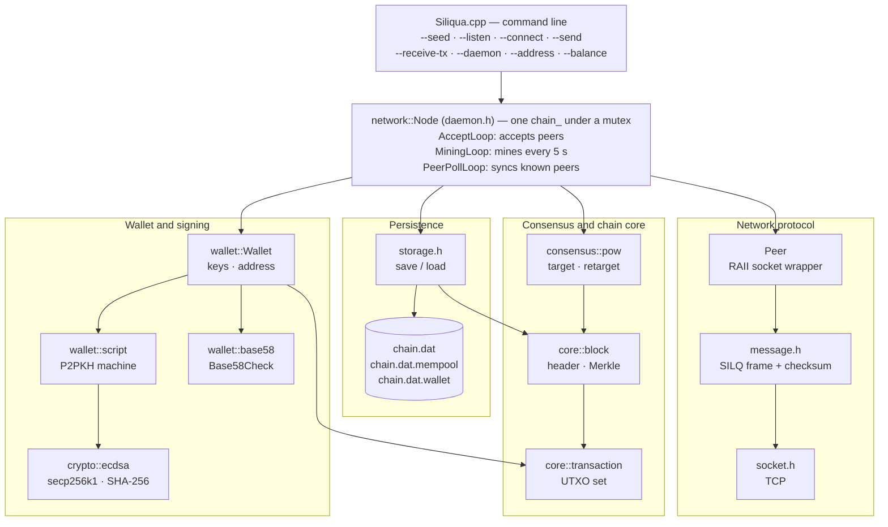
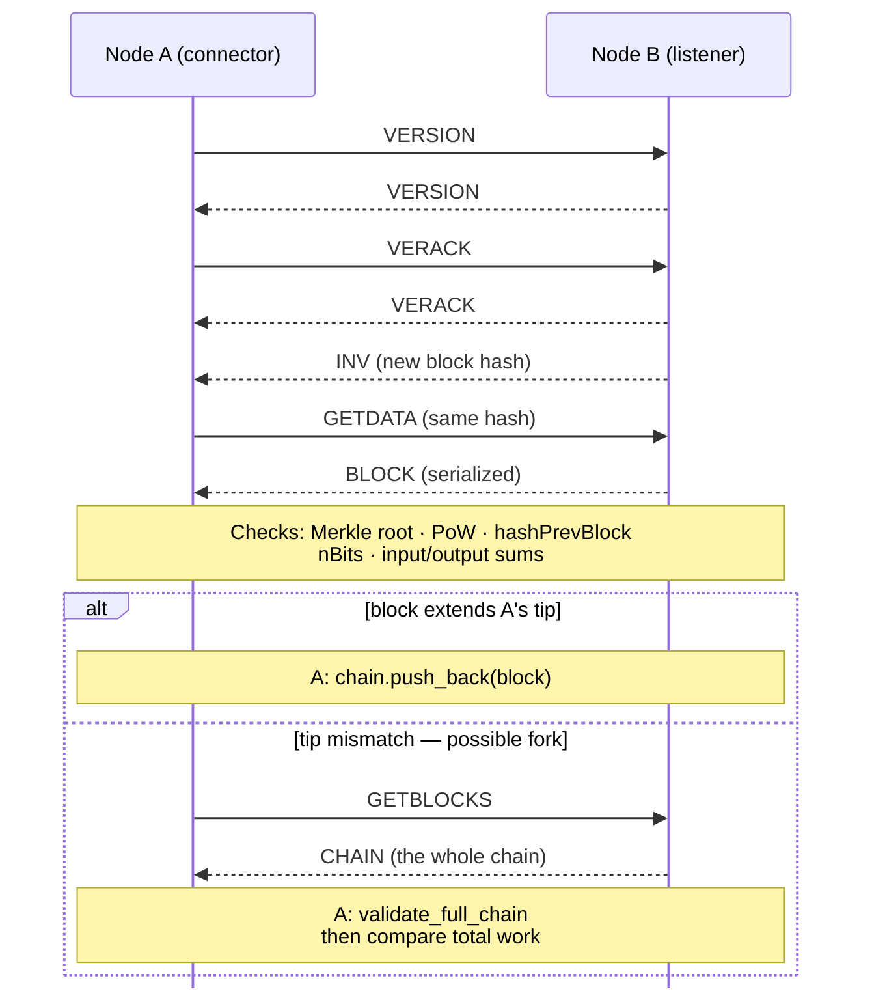

# Siliqua
**Siliqua - Bitcoin-like blockchain прототип** с реализацией UTXO, Proof-of-Work, P2PKH-скриптов, secp256k1-подписей и бинарного P2P-протокола на чистом C++23.<br><br>
**Siliqua is the Bitcoin-like blockchain prototype** with implementation of UTXO, Proof-of-Work, P2PKH scripts, secp256k1 signatures, and a binary P2P protocol in plain C++23.

👤 [Об авторе / About](#contact-me)

Полная документация на русском языке доступна отдельными файлами в [`Siliqua/docs/`](Siliqua/docs/): [ARCHITECTURE.ru.md](Siliqua/docs/ARCHITECTURE.ru.md) и **живые интерактивные HTML-схемы** через GitHub Pages: [architecture.ru.html](https://crypt0xCode.github.io/Siliqua/architecture.ru.html).<br><br>
The full english documentation is also available as standalone files in [`Siliqua/docs/`](Siliqua/docs/): [ARCHITECTURE.en.md](Siliqua/docs/ARCHITECTURE.en.md), and **live interactive HTML diagrams** served via GitHub Pages: [architecture.en.html](https://crypt0xCode.github.io/Siliqua/architecture.en.html).

---
#### Cryptography and addresses
* Keypair generation based on the secp256k1 library: seckey/pubkey/compressed pubkey.<br>
* ECDSA signing and signature verification.<br>
* SHA-256, double SHA-256, RIPEMD-160 hashing.<br>
* Base58Check address encoding (own version byte 0x1E).<br>

#### Chain core
* Transaction structures: COutPoint, CTxIn, CTxOut, Transaction.<br>
* Double SHA-256 hash of a transaction and a block (GetHash).<br>
* Serialization, deserialization of transactions and blocks into a binary format.<br>
* Merkle Root and its verification (IsMerkleRootValid).<br>
* UTXO model (unordered_map<COutPoint, CTxOut>).<br>

#### Consensus and economics
* Proof-of-Work: converting the compact target nBits into a 256-bit target.<br>
* Block mining (brute-forcing nNonce, rolling nTime on overflow).<br>
* Mining difficulty change (same rule as Bitcoin, clamped to [0.25x, 4x]).<br>
* Total chain work calculation for fork selection.<br>
* Full from-scratch chain validation (validate_full_chain).<br>
* Fees as the difference between the sum of inputs and outputs.<br>
* Block reward halving (a simplified analogue of Bitcoin's 210,000 blocks).<br>

#### Scripts and wallet
* P2PKH scriptPubKey, scriptSig (OP_DUP, OP_HASH160, OP_EQUALVERIFY, OP_CHECKSIG).<br>
* Stack machine for script execution (script::evaluate).<br>

#### P2P network protocol
* Own binary protocol over TCP (magic bytes "SILQ" from Siliqua).<br>
* Message framing: magic + command + length + checksum.<br>
* Commands: VERSION, VERACK, INV, GETDATA, BLOCK, TX, GETBLOCKS, CHAIN.<br>
* Cross-platform sockets (Winsock/POSIX) behind one interface.<br>

#### Node and daemon
* One-shot CLI operations: run_listener, run_connector, run_send_tx, run_receive_tx.<br>
* Persistent multi-threaded daemon (network::Node): AcceptLoop, MiningLoop, PeerPollLoop.<br>
* Mempool with a size cap (MAX_MEMPOOL_SIZE).<br>
* Accepting and validating peer blocks, extending the chain (try_extend_chain).<br>
* Fork resolution by total work (try_reorg), not chain length.<br>
* Multi-peer daemon mode (list of known peers, periodic sync).<br>
* Follower mode `--no-mine`: a daemon that syncs and accepts transactions but never mines.<br>

#### Storage
* Binary (de)serialization of the whole chain to a file.<br>
Persistence:<br>
* the UTXO set to a file (`save_utxo_set`/`load_utxo_set`; only the demonstration mode uses them, nodes rebuild the UTXO set from the chain);<br>
* the mempool to a file;<br>
* the wallet (seckey) to a file, restored across runs.<br>

#### CLI Commands
*See a usage example in [Chapter 11](#chapter-11-cli-commands-and-a-two-node-scenario).*<br>
✅ `--seed <path>` - mine a "clean" genesis chain once (just block 0) and save it to a file. The genesis reward goes to a neutral, all-zero address that nobody owns, so every node that copies this file starts from the same mark.<br>
✅ `--listen <port> [chain_path]` - mine one new block on top of the current chain, then listen on a TCP port and serve one connecting client (peer): complete the handshake and hand it that new block.<br>
✅ `--connect <host> <port> [chain_path]` - connect to a peer (a node running `--listen`), fetch a block from it, and, if it's valid and extends its own chain, append it to chain_path. If the block doesn't extend the local tip, instead of rejecting it the node requests the peer's whole chain and compares total work (the fork-resolution rule).<br>
✅ `--address <chain_path>` - print this node's wallet address in Base58Check form to the console (loads or creates `<chain_path>.wallet`).<br>
✅ `--balance <chain_path>` - print a list of its own unspent UTXOs and their total in satoshi (sats).<br>
✅ `--send <host> <port> <chain_path> <address> <sum>` - build and sign a transaction spending the node's own UTXOs (plus a flat DEFAULT_FEE), and send it to a peer. The peer drops it into its own mempool.<br>
✅ `--receive-tx <port> <chain_path>` - listen on a port, accept exactly one transaction from a peer, check its signature, its UTXOs, and, if valid, add it to its own mempool (the transaction waits for the next `--listen` run to make it into a block).<br>
✅ `--daemon <port> <chain_path> [host:port ...] [--no-mine]` - start a persistently running node (network::Node). Unlike every command above, it doesn't exit after one peer or one operation. The daemon accepts any number of connections at once (transactions sent to it land in its mempool), mines blocks on a timer (every 5s), and syncs itself with a list of known peers by polling them (effectively has the functionality of every command listed above). With `--no-mine` the node is a *follower*: it accepts peers and transactions and syncs, but never mines. Keep exactly one miner in a network - two mining daemons fork away from each other, and a payment that spends coins from the losing fork is rejected.<br>

*Notes:* spdlog debug output is printed to the console together with the result (for `--address` the address is the last line, for `--balance` it is the line `N UTXO(s), M satoshi total.`). `--help` (or `-h`) prints the command list. An unknown flag, a wrong number of arguments, or an invalid port, amount or recipient address makes the binary print an explanation and the usage line of that command and exit with code 2. An exception raised while running (for example `connect()` failing) is reported as `Error: ...` with exit code 1 instead of aborting the process. Only a start without any arguments runs the demonstration mode: it asks for a string, prints its SHA-256 and double SHA-256, generates a keypair, a signature and an address, builds sample transactions and writes `utxo.dat` into the current folder.

#### Build
* Cross-platform CMake (Windows/Linux/macOS), C++23.<br>
* secp256k1 and Crypto++ discovery via pkg-config (fallback: find_library/find_path); on Windows they are taken from `Siliqua/libs/`.<br>
* Optimized for weak, old hardware (-O2 instead of -O3).<br>
* Integration test scripts: `scripts/multi_node_test.sh` (three-node consensus check) and `scripts/fork_test.sh` (fork resolution by total work).

---

### Chapter 1: Introduction

#### Project name
Siliqua is a prototype of a peer-to-peer (P2P) Bitcoin-like blockchain, written in C++ with no external blockchain frameworks.

#### Project goal
Reproduce Bitcoin's key architectural and algorithmic patterns (UTXO, Proof-of-Work, the P2P protocol, scripts, halving, fees) in a compact, readable codebase optimized to run on weak/old hardware.

#### Technology stack

| Component            | Technology                                                       |
|-----------------------|--------------------------------------------------------------------|
| Language              | C++23                                                              |
| Cryptography (ECDSA)  | libsecp256k1                                                       |
| Hashing               | picosha2 (SHA-256), Crypto++ (RIPEMD-160)                          |
| Networking            | "raw" TCP sockets (POSIX, Winsock), a custom binary protocol       |
| Platform support      | CMake ≥ 3.15, cross-platform (Windows, Linux, macOS)               |
| Storage               | "raw" binary files (chain.dat, *.wallet, *.mempool)                |

#### Core platform features
- Wallet generation (secp256k1 keypair) and Base58Check addresses.<br>
- Sending and receiving signed transactions with a fee.<br>
- Mining blocks with Proof-of-Work and a block reward (with halving).<br>
- Validating incoming blocks and transactions (signatures, UTXOs, sums).<br>
- Fork resolution by total chain work, not length.<br>
- A persistently running node (daemon) syncing with multiple peers.<br>
- Persistence of the chain, UTXO, mempool, and wallet across runs.

#### Development milestones
Based on the repository's commit history:

| Milestone                                       | Key results |
|--------------------------------------------------| -------------------- |
| Project bootstrap, cross-platform CMake         | Windows, Linux, macOS build |
| Cryptography layer                              | ECDSA (seckey, pubkey, signing, verification), address generation |
| Core: transactions and blocks                   | COutPoint, CTxIn, CTxOut, CBlockHeader, CBlock, Merkle Root |
| Consensus: Proof-of-Work                        | compact target ↔ 256-bit, mining, PoW check |
| Persistence                                     | serialization, deserialization of the chain and UTXO to files |
| P2P protocol                                    | messages, VERSION, VERACK handshake, sockets |
| First block exchange between nodes              | Listener, Connector, test transaction generator |
| Wallets and signing                             | Wallet class, unique wallet generator, per-address UTXOs |
| Network economics                               | fees, halving, mempool limit |
| Real Bitcoin scripts                            | scriptPubKey, scriptSig, P2PKH stack machine |
| Multi-peer daemon                               | multi-threaded Node (Accept, Mining, PeerPoll), Base58 addresses |

---

### Chapter 2: Architecture diagram
#### System components
- **CLI (`Siliqua.cpp`):** parses launch flags, dispatches to a one-shot operation or the daemon.<br>
- **`network::Node` (daemon, `daemon.h`):** accepting peers, mining on a timer, polling known peers, one shared chain under `std::mutex`.<br>
- **Consensus (`consensus/pow.h`):** target conversion, mining, mining difficulty change, total chain work.<br>
- **Core (`core/block.h`, `core/transaction.h`):** block and transaction structures, Merkle Root, the UTXO set.<br>
- **Wallet (`wallet/*.h`):** keys, addresses (Base58Check), building and signing transactions, P2PKH scripts.<br>
- **Crypto (`crypto/ecdsa.h`):** a wrapper over secp256k1 and the hash functions.<br>
- **Network (`network/*.h`):** message framing, TCP sockets (POSIX, Windows).<br>
- **Storage (`storage/storage.h`):** binary persistence of the chain, UTXO, mempool, wallet to files.<br>

#### Dependency graph and control-flow threads

**Legend:** an arrow `A --> B` means "A uses B" (in the code: an `#include` and calls, checked against the headers); a rectangle - a module or class; a cylinder - a file on disk. The consensus and chain core uses none of the other groups.

#### Handshake and block exchange between two nodes
The same request cycle `run_connector` uses: if the received block doesn't extend the node's own tip, it isn't dropped right away — the node requests the peer's whole chain and compares total work (Bitcoin's rule: the winner is the chain with the most work, not the longest one).

The full table of the economic constants shown on the diagrams is in [Chapter 10](#chapter-10-network-economics-and-limits).

---

### Chapter 3: Cryptography and addresses
*Code snippets in Chapters 3-9 are abridged (signatures without bodies, some braces and comments omitted); the full code is in `Siliqua/include/`.*

#### Hash functions and signing (`crypto/ecdsa.h`)
```cpp
namespace crypto {
    inline void hash_sha256(const std::vector<uint8_t>& input, std::array<uint8_t, 32>& output);
    inline void hash_double_sha256(const std::vector<uint8_t>& input, std::array<uint8_t, 32>& output);
    inline void hash_ripemd160(unsigned char* ripemd160_hash, unsigned char* input, size_t len);

    int generate_keypair(std::string input, std::vector<std::string>& keypair,
        unsigned char* seckey, secp256k1_pubkey& pubkey, unsigned char* compressed_pubkey);
    int create_address_from_pubkey(unsigned char* compressed_pubkey,
        unsigned char* ripemd160_hash, std::string& ripemd160_hash_string);
    int generate_sign(std::string input, unsigned char* seckey,
        unsigned char* serialized_signature, std::string& str_signature,
        secp256k1_ecdsa_signature& sig, unsigned char* input_hash);
    int verify_sign(secp256k1_ecdsa_signature& sig, unsigned char* serialized_signature,
        secp256k1_pubkey& pubkey, unsigned char* compressed_pubkey, unsigned char* input_hash);
}
```
Address = `RIPEMD160(SHA256(compressed_pubkey))`, 20 bytes (`wallet::ADDRESS_SIZE`).

#### Base58Check addresses (`wallet/base58.h`)
The same algorithm real Bitcoin uses: an alphabet without look-alike characters (0/O, I/l) plus a checksum to catch typos. Its own version byte, so a Siliqua address is never mistaken for a real Bitcoin address:
```cpp
constexpr uint8_t ADDRESS_VERSION_BYTE = 0x1E;

inline std::string encode_address(const std::array<uint8_t, ADDRESS_SIZE>& address) {
    std::vector<uint8_t> payload;
    payload.push_back(ADDRESS_VERSION_BYTE);
    payload.insert(payload.end(), address.begin(), address.end());

    std::array<uint8_t, 32> checksum{};
    crypto::hash_double_sha256(payload, checksum);
    payload.insert(payload.end(), checksum.begin(), checksum.begin() + 4);

    return base58_encode(payload);
}
```
`decode_address()` - the reverse operation, checking the version and the checksum (throws on a typo).

#### Message signing (`wallet/signing.h`)
```cpp
constexpr size_t SIGNATURE_SIZE = 64; // secp256k1 compact signature
constexpr size_t PUBKEY_SIZE = 33;    // compressed pubkey

std::vector<uint8_t> sign_raw(const unsigned char seckey[32], const std::array<uint8_t, 32>& sighash);
bool verify_raw_signature(const std::vector<uint8_t>& sig_bytes,
    const std::vector<uint8_t>& pubkey_bytes, const std::array<uint8_t, 32>& sighash);
```
What gets signed is the transaction hash computed **with every `scriptSig` empty** (the same idea as Bitcoin's `SIGHASH_ALL`; a signature cannot depend on its own bytes).

---

### Chapter 4: Transactions and the UTXO model
#### Structures (`core/transaction.h`)
| Structure     | Fields                                              | Purpose                                   |
| ------------- | ---------------------------------------------------- |------------------------------------------|
| `COutPoint`   | `txid[32]`, `n`                                       | pointer to a specific output of a past tx |
| `CTxIn`       | `prevout`, `scriptSig`, `nSequence`                   | an input (spends one UTXO)                |
| `CTxOut`      | `nValue` (satoshi), `scriptPubKey`                    | an output (new unconfirmed balance)       |
| `Transaction` | `nVersion`, `vin`, `vout`, `nLockTime`, `tx_hash`     | the whole transaction                     |

#### Hash and coinbase
```cpp
std::array<uint8_t, 32> Transaction::GetHash() const;  // double SHA-256 of the serialized tx
bool Transaction::IsCoinbase() const;                  // checks whether this is the coinbase (the first transaction in a block, which pays the miner's reward)
```

#### Building the UTXO set from the whole chain (`network/node.h`)
```cpp
inline transaction::UtxoSet build_utxo_set(const std::vector<block::CBlock>& chain) {
    transaction::UtxoSet utxos;
    for (const auto& blk : chain)
        for (const auto& tx : blk.vtx)
            for (uint32_t i = 0; i < tx.vout.size(); ++i)
                utxos.emplace(transaction::COutPoint(tx.tx_hash, i), tx.vout.at(i));
    for (const auto& blk : chain)
        for (const auto& tx : blk.vtx)
            for (const auto& in : tx.vin)
                utxos.erase(in.prevout);
    return utxos;
}
```

#### Validating a transaction and computing its fee
```cpp
// fee (>= 0) if tx is valid; -1 if not.
inline int64_t validate_and_get_fee(const transaction::Transaction& tx, const transaction::UtxoSet& utxo_set) {
    if (tx.vin.empty()) return -1;
    int64_t input_total = 0;
    for (size_t i = 0; i < tx.vin.size(); ++i) {
        auto it = utxo_set.find(tx.vin.at(i).prevout);
        if (it == utxo_set.end() || !wallet::verify_transaction_signature(tx, i, it->second.scriptPubKey))
            return -1;
        input_total += it->second.nValue;
    }
    int64_t output_total = 0;
    for (const auto& out : tx.vout) output_total += out.nValue;
    if (output_total > input_total) return -1;
    return input_total - output_total; // the difference is the fee
}
```

---

### Chapter 5: Blocks and Proof-of-Work
#### Block header (`core/block.h`)
```cpp
struct CBlockHeader {
    int32_t nVersion;
    std::array<uint8_t, 32> hashPrevBlock;
    std::array<uint8_t, 32> hashMerkleRoot;
    uint32_t nTime;
    uint32_t nBits;   // compact target
    uint32_t nNonce;

    std::array<uint8_t, 32> GetHash() const;
};

class CBlock : public CBlockHeader {
public:
    std::vector<transaction::Transaction> vtx;
    std::array<uint8_t, 32> BuildMerkleRoot() const;
    bool IsMerkleRootValid() const;
    bool IsValid() const;
};
```

#### Compact target => 256 bit (`consensus/pow.h`)
The top byte of `nBits` is the exponent (byte length), the low 3 bytes are the mantissa, the same as in Bitcoin:
```cpp
inline std::array<uint8_t, 32> bits_to_target(uint32_t bits);
inline bool check_proof_of_work(const block::CBlockHeader& header); // hash <= target
inline void mine_block(block::CBlockHeader& header, uint32_t nBitsTarget); // brute-forces nNonce
```

#### Difficulty retargeting
```cpp
constexpr uint32_t RETARGET_INTERVAL = 5;         // blocks between recalculations
constexpr uint32_t TARGET_TIMESPAN_SECONDS = 60;  // expected time for the interval
constexpr uint32_t INITIAL_BITS = 0x207fffff;

// actual_timespan is clamped to [target/4, target*4] — a burst of fast/slow blocks can't swing the difficulty by more than 4x in one retarget.
uint32_t get_next_work_required(const std::vector<block::CBlockHeader>& headers,
    uint32_t retarget_interval, uint32_t target_timespan_seconds);
```

#### Fork selection — by total work, not by length
```cpp
double calculate_block_work(uint32_t nBits);              // 2^256 / target
double calculate_chain_work(const std::vector<block::CBlockHeader>& headers);
```
Bitcoin's key rule, reproduced here: the chain with the greatest **total work** wins (`try_reorg` in `node.h`), not simply the longer one. It usually coincides, but not always.

#### Block reward and halving (`network/node.h`)
```cpp
constexpr int64_t INITIAL_REWARD = 5000000000; // 50 coins, block 0
constexpr uint32_t HALVING_INTERVAL = 10;      // blocks per halving (for a testable demonstration)

inline int64_t calculate_block_reward(uint32_t height) {
    uint32_t halvings = height / HALVING_INTERVAL;
    if (halvings >= 63) return 0;
    return INITIAL_REWARD >> halvings;
}
```
The coinbase input encodes the block height in `scriptSig` (the same idea as Bitcoin's BIP34) — otherwise two blocks with the same reward from the same address would produce an identical `tx_hash` and collide in the UTXO set.

---

### Chapter 6: P2PKH scripts

#### Opcodes (`wallet/script.h`)

| Opcode            | Code    | Action                                                    |
| ------------------- | ------ | -------------------------------------------------------------- |
| `OP_DUP`             | `0x76` | duplicates the top of the stack                                |
| `OP_HASH160`         | `0xa9` | `RIPEMD160(SHA256(x))` of the top of the stack                 |
| `OP_EQUALVERIFY`     | `0x88` | compares the top two elements, aborts on mismatch               |
| `OP_CHECKSIG`        | `0xac` | verifies a signature against the sighash                         |

#### Building scripts
```cpp
// OP_DUP OP_HASH160 <push 20-byte address> OP_EQUALVERIFY OP_CHECKSIG
std::vector<uint8_t> build_p2pkh_script_pubkey(const std::array<uint8_t, wallet::ADDRESS_SIZE>& address);

// <push signature><push pubkey>
std::vector<uint8_t> build_script_sig(const std::vector<uint8_t>& signature, const std::vector<uint8_t>& pubkey);
```

#### Execution (the stack machine)
`scriptSig` and `scriptPubKey` are concatenated and run as one program, the same as in real Bitcoin. A spend is valid if the stack ends with exactly one truthy value:
```cpp
bool evaluate(const std::vector<uint8_t>& script_sig,
    const std::vector<uint8_t>& script_pubkey, const std::array<uint8_t, 32>& sighash);
```
This isn't the full Bitcoin Script language (~100 opcodes), just the minimum needed for classic P2PKH.

---

### Chapter 7: P2P network protocol
#### Message frame format (`network/message.h`)
| Field       | Size       | Description                                       |
| ----------- | ---------- | -------------------------------------------------------- |
| magic       | 4 bytes    | `"SILQ"` — not to be confused with real Bitcoin traffic  |
| command     | 12 bytes   | command name, zero-padded                                 |
| length      | 4 bytes LE | payload length                                             |
| checksum    | 4 bytes    | first 4 bytes of double-SHA256(payload)                    |
| payload     | variable   | the message body                                           |

```cpp
inline constexpr std::array<uint8_t, 4> MAGIC_BYTES = { 'S', 'I', 'L', 'Q' };
inline constexpr uint32_t MAX_PAYLOAD_SIZE = 4 * 1024 * 1024; // guards against a hostile length field
```

#### Protocol commands
| Command      | Direction                          | Purpose                                        |
| ------------- | ------------------------------------ | ------------------------------------------------- |
| `version`     | initiator => recipient               | protocol version negotiation                     |
| `verack`      | recipient => initiator               | handshake acknowledgement                          |
| `inv`         | listener => connector                | announces the new block's hash                    |
| `getdata`     | connector => listener                | requests a block by hash                           |
| `block`       | listener => connector                | the serialized block                               |
| `tx`          | sender => recipient                  | a signed transaction for the mempool               |
| `getblocks`   | connector => listener                | requests the whole chain (for fork resolution)     |
| `chain`       | listener => connector                | the whole chain (`storage::serialize_chain`)       |

#### The Peer class — an RAII socket wrapper (`network/peer.h`)
```cpp
class Peer {
public:
    explicit Peer(socket_t sock) : sock_(sock) {}
    ~Peer() { close_socket(sock_); }
    Peer(const Peer&) = delete; // a socket has exactly one owner

    bool Send(const std::string& cmd, const std::vector<uint8_t>& payload) const;
    bool Receive(Message& out) const;
};
```

---

### Chapter 8: The node — CLI modes and the persistent daemon
#### One-shot operations (`network/node.h`)
Each function performs exactly one exchange with exactly one peer and exits:

| Function              | What it does                                                                                                              |
| ---------------------- |-----------------------------------------------------------------------------------------------------------------------------|
| `run_listener`         | mines a new block on top of its own chain, listens on a port, serves one peer                                              |
| `run_connector`        | connects to a peer, fetches a block; if it doesn't extend its own tip, requests the peer's whole chain and compares total work |
| `run_send_tx`          | builds and signs a transaction from its own UTXOs, sends it to a peer's mempool                                            |
| `run_receive_tx`       | accepts one transaction, checks its signature/UTXOs, drops it into the mempool                                             |

#### The persistent daemon `network::Node` (`network/daemon.h`)
```cpp
class Node {
public:
    Node(uint16_t listen_port, const std::string& chain_path, std::vector<PeerAddress> known_peers, bool mine = true);
    [[noreturn]] void Run(); // starts 3 threads (2 when mine == false) and never returns control

private:
    [[noreturn]] void AcceptLoop();    // accepts peers, each on its own detached thread
    void HandleConnection(socket_t client_sock);
    void AcceptTransaction(const transaction::Transaction& tx, const std::string& prefix);
    [[noreturn]] void MiningLoop();    // mines a block from the mempool every DAEMON_CYCLE_SECONDS
    [[noreturn]] void PeerPollLoop();  // polls known_peers_ every DAEMON_CYCLE_SECONDS
    void PollPeer(const PeerAddress& addr);

    std::mutex mutex_;                 // guards chain_ from races between the three loops
    std::vector<block::CBlock> chain_;
    bool mine_;                        // false = --no-mine: the MiningLoop thread is never started
};
```

With `--no-mine` (`mine == false`) `Run()` skips the MiningLoop: the node still accepts peers, stores their transactions in its mempool and polls `known_peers_`, but only ever adopts blocks mined by someone else. The daemon *pulls* blocks (PeerPollLoop asks each known peer for its tip and, if that does not extend ours, for the whole chain); a `BLOCK` pushed to it is not accepted, so a new block shows up on a follower within one cycle (about 5 s).

#### Accepting a block and fork resolution
```cpp
bool try_extend_chain(std::vector<block::CBlock>& chain, const block::CBlock& received_block);
bool try_reorg(std::vector<block::CBlock>& chain, const std::vector<block::CBlock>& peer_chain);
bool validate_full_chain(const std::vector<block::CBlock>& chain); // from scratch, from genesis
```
The full exchange sequence is shown in the diagram in [Chapter 2](#chapter-2-architecture-diagram) (handshake and block exchange).

---

### Chapter 9: Storage (`storage/storage.h`)

| File                   | Format                                                                       |
|------------------------| --------------------------------------------------------------------------- |
| `<chain_path>`         | block count (varint) + each block's `Serialize()` back to back              |
| `<chain_path>.wallet`  | 32 raw bytes of the seckey                                                  |
| `<chain_path>.mempool` | tx count (varint) + each transaction's `Serialize()` back to back           |
| `<any>.utxo`           | entry count (varint) + pairs of `COutPoint::Serialize()`+`CTxOut::Serialize()` |

The `.utxo` file is written only by the demonstration mode (`utxo.dat`); `--listen`, `--connect`, `--daemon` and the other modes rebuild the UTXO set from the chain.

```cpp
void save_chain(const std::vector<block::CBlock>& chain, const std::string& path);
std::vector<block::CBlock> load_chain(const std::string& path);
void save_mempool(const std::vector<transaction::Transaction>& mempool, const std::string& path);
std::vector<transaction::Transaction> load_mempool(const std::string& path);
```

---

### Chapter 10: Network economics and limits

| Constant                    | Value              | Meaning                                                    | File                    |
| ------------------------------ | -------------------- | ------------------------------------------------------------ | ----------------------- |
| `INITIAL_REWARD`               | 5,000,000,000        | 50 coins — the reward for block 0, before halving             | `network/node.h`        |
| `HALVING_INTERVAL`             | 10 blocks            | reward halves every N blocks                                   | `network/node.h`        |
| `DEFAULT_FEE`                  | 1000 satoshi          | flat fee paid by `run_send_tx`                                 | `network/node.h`        |
| `RETARGET_INTERVAL`            | 5 blocks             | how often difficulty is recomputed                             | `network/node.h`        |
| `TARGET_TIMESPAN_SECONDS`      | 60 s                 | expected time for `RETARGET_INTERVAL` blocks                   | `network/node.h`        |
| `MAX_MEMPOOL_SIZE`             | 1000 tx              | cap on unconfirmed transactions                                | `network/node.h`        |
| `DUST_THRESHOLD`               | 1000 satoshi          | change below this isn't split into its own UTXO                | `wallet/wallet.h`       |
| `DAEMON_CYCLE_SECONDS`         | 5 s                  | period of the MiningLoop and PeerPollLoop cycles                | `network/daemon.h`      |
| `ADDRESS_VERSION_BYTE`         | `0x1E`               | own address prefix (not Bitcoin mainnet)                        | `wallet/base58.h`       |
| `MAGIC_BYTES`                  | `"SILQ"`             | marks Siliqua traffic apart from real Bitcoin P2P                | `network/message.h`     |

Values are intentionally small (a halving every 10 blocks, a retarget every 5): the behavior can be observed in a single test run rather than over years, as in real Bitcoin.

---

### Chapter 11: CLI, commands and a two-node scenario
#### Flag reference (`src/Siliqua.cpp`) is listed in the [CLI](#cli-commands) section
#### Practical scenario: two nodes, one transfer
```bash
# 1. Node A seeds the genesis chain.
./Siliqua --seed nodeA.dat

# 2. Node B copies the same genesis before A mines the next block:
#    run_connector requires an already-existing chain sharing that genesis,
#    otherwise the very first received block won't link via hashPrevBlock
#    and will be rejected.
cp nodeA.dat nodeB.dat

# 3. Node A mines block 1 on top of its chain and listens on port 9000.
./Siliqua --listen 9000 nodeA.dat &

# 4. Node B connects, fetches block 1, and appends it to its own copy of the chain.
./Siliqua --connect 127.0.0.1 9000 nodeB.dat

# 5. Check node A's addresses and balance (block 1's reward went to its wallet).
./Siliqua --address nodeA.dat
./Siliqua --address nodeB.dat
./Siliqua --balance nodeA.dat

# 6. Node B listens on a port to receive a transaction.
./Siliqua --receive-tx 9001 nodeB.dat &

# 7. Node A sends part of its balance to node B's address (from step 5).
./Siliqua --send 127.0.0.1 9001 nodeA.dat <node_B_address> 100000

# 8. A persistent daemon instead of one-shot commands. 127.0.0.1:9001 is an example peer:
#    the --receive-tx run from step 6 has already exited, so start a node there or omit the peer.
#    Several machines: see the hub + follower scenario below (--no-mine).
./Siliqua --daemon 9000 nodeA.dat 127.0.0.1:9001
```

#### Practical scenario: two computers over one port (hub + follower)
A hub (for example a Windows PC with a public IP, here `HUB_IP`) runs the only miner; a follower (for example a Mac) syncs from it and never mines. **Only the hub needs an open inbound port** (here TCP 9000) - the follower only connects out.

Before you start on the hub:
* allow inbound TCP 9000 in the firewall for the *active* network profile (Private/Public), and forward TCP 9000 from the router to the hub's LAN address; on Windows `libsecp256k1-6.dll` must sit next to `Siliqua.exe`;
* start the daemon (step 3 below) and check from the follower: `nc -vz -G 5 HUB_IP 9000`. `succeeded` = reachable; `Connection refused` = the packet arrived, nothing is listening; `Operation timed out` = a firewall, the router or the provider (CGNAT) drops it.

```bash
# 1. Hub: seed the shared genesis chain, then copy ONLY chain.dat to the follower
#    (never copy *.wallet - every node keeps its own keys). On Windows use .\Siliqua.exe.
./Siliqua --seed chain.dat

# 2. Both machines: print the wallet address (it is the last line of the output).
./Siliqua --address chain.dat

# 3. Hub, terminal 1: start the miner and leave it running.
./Siliqua --daemon 9000 chain.dat

# 4. Follower, terminal 1: start a non-mining node that syncs from the hub.
./Siliqua --daemon 9000 chain.dat HUB_IP:9000 --no-mine

# 5. Hub, terminal 2 (after ~10 s, once the first blocks are mined): pay the follower 10 coins.
#    Amounts are in satoshi; the fee of 1000 is added automatically.
./Siliqua --send 127.0.0.1 9000 chain.dat FOLLOWER_ADDRESS 1000000000

# 6. Follower, terminal 2 (after ~10 s: the hub mines the payment, the follower pulls the block).
./Siliqua --balance chain.dat

# 7. Follower, terminal 2: pay the hub back; the follower daemon keeps running.
./Siliqua --send HUB_IP 9000 chain.dat HUB_ADDRESS 300000000

# 8. Both machines after ~10 s: check the balances.
./Siliqua --balance chain.dat
```
The follower ends with `699999000` satoshi (1000000000 - 300000000 - 1000 fee). The hub's balance is its mined rewards minus 1000000000 plus 300000000 plus the 1000 fee it collected as the miner. Stop the daemons with `Ctrl+C`. `scripts/daemon_hub_test.sh` runs this exact flow with both daemons on one machine and checks these numbers.

#### The same scenario without daemons (one listener at a time)
If you prefer to step through every round by hand, only the hub listens on port 9000, and only one command at a time:
1. Hub: `--listen 9000 chain.dat` (mines a block), then follower: `--connect HUB_IP 9000 chain.dat`.
2. Payment hub -> follower: on the hub, terminal 1 `--receive-tx 9000 chain.dat`, terminal 2 `--send 127.0.0.1 9000 chain.dat FOLLOWER_ADDRESS 1000000000`; then again `--listen 9000 chain.dat` on the hub and `--connect HUB_IP 9000 chain.dat` on the follower.
3. Payment follower -> hub: hub `--receive-tx 9000 chain.dat`, follower `--send HUB_IP 9000 chain.dat HUB_ADDRESS 300000000`; then `--listen` on the hub and `--connect` on the follower once more.

Pitfalls of this variant:
* `--receive-tx` accepts a transaction, `--listen` does not: a `tx` sent to a `--listen` node is dropped with `Unexpected command 'tx'` - and that node has already mined and saved a block, so the hub is now one block ahead of the follower.
* After every `--listen` the follower must run `--connect`: it fetches exactly one block, and a block that does not link to its tip is rejected. If a round was missed, copy `chain.dat` from the hub again (the follower's `.wallet` is separate and stays untouched).

---

### Chapter 12: Building the project

#### Dependencies
The code uses `<print>` / `std::println` (C++23), so the compiler's standard library has to provide it: verified with Apple clang 17 and 21; with GCC use version 14 or newer (GCC 13 has no `<print>`).

##### Linux (Debian):
```bash
sudo apt update
sudo apt install cmake
sudo apt install g++-14 gcc-14

cmake --version
g++-14 --version

sudo apt install libsecp256k1-dev
sudo apt install libcrypto++-dev
```
If libsecp256k1-dev isn't found in the distribution's repository, build it manually:
```bash
git clone https://github.com/bitcoin-core/secp256k1.git
cd secp256k1 && ./autogen.sh && ./configure && make -j$(nproc) && sudo make install
```

##### macOS:
```zsh
xcode-select --install
brew install cmake

cmake --version
clang++ --version

brew install secp256k1
brew install cryptopp
```
##### Windows:
`libsecp256k1.lib` and `cryptlib.lib` in `Siliqua/libs/` are stored in Git LFS, so Git LFS is required (`libsecp256k1-6.dll` is a regular file):
```powershell
winget install GitHub.GitLFS
git lfs install
git lfs pull
```
Then install MS Visual Studio 2022 with the C++ desktop development component, or MSYS2:
```powershell
winget install MSYS2.MSYS2
# next in the MSYS2 UCRT64 terminal:
pacman -S mingw-w64-ucrt-x86_64-gcc mingw-w64-ucrt-x86_64-cmake
```

#### Build
##### Linux (Debian):
```bash
mkdir -p build && cd build
cmake -DCMAKE_CXX_COMPILER=g++-14 -DCMAKE_BUILD_TYPE=Release ..
cmake --build . --config Release -j$(nproc)

# The built binary is located at Siliqua/bin/Siliqua
```
##### macOS:
```zsh
mkdir -p build && cd build
cmake -DCMAKE_BUILD_TYPE=Release ..
cmake --build . --config Release -j$(sysctl -n hw.ncpu)

# The built binary is located at Siliqua/bin/Siliqua
```
##### Windows:
*`libsecp256k1-6.dll` has to be in the same folder as `Siliqua.exe`: Windows does not look in `Siliqua/libs/`. The CMake build copies it there automatically after linking; if you run an older build or move the exe, copy the DLL next to it manually.*
```powershell
mkdir build; cd build
cmake -DCMAKE_BUILD_TYPE=Release ..
cmake --build . --config Release

# The built binary is located at Siliqua\bin\Siliqua.exe or Siliqua\bin\Release\Siliqua.exe
```

#### CMakeLists.txt highlights
Single-config generators (Make/Ninja) don't optimize by default unless a build type is given explicitly - we force Release, so `cmake .. && cmake --build .` immediately produces an optimized binary.
```cmake
set(CMAKE_CXX_STANDARD 23)
set(CMAKE_CXX_STANDARD_REQUIRED ON)

if(NOT CMAKE_BUILD_TYPE AND NOT CMAKE_CONFIGURATION_TYPES)
    set(CMAKE_BUILD_TYPE Release CACHE STRING "Build type" FORCE)
endif()
```
`-O2` instead of `-O3` on GCC/Clang in Release is a deliberate choice for compatibility with weak or old hardware (no auto-vectorization targeting instructions that may not be available on the target CPU).

#### Threads
`network/daemon.h` uses `std::thread`; on Linux this requires `-lpthread`, resolved via `Threads::Threads` instead of a platform-specific flag.

#### Tests
The scripts in `Siliqua/scripts/` need a built `bin/Siliqua`; run them from the `Siliqua/` folder. Working files go to `/tmp/siliqua_*` or to the folder given as the first argument:
```bash
cd Siliqua
./scripts/multi_node_test.sh   # A mines, A pays B, B mines the payment, C syncs; B and C chains must be byte-identical
./scripts/fork_test.sh         # E reorgs onto the heavier branch and does not switch back to the lighter one
./scripts/daemon_hub_test.sh  # hub (mining daemon) + follower (--no-mine daemon): two payments in both directions, exact balances, the follower mines nothing
```
A passing run exits with code 0 and prints `OK: ...` lines. The scripts count blocks from 1 (genesis is #1), so "block #2" in their output is "block 1" in [Chapter 11](#chapter-11-cli-commands-and-a-two-node-scenario).

---

### Contact Me
*English*: I'm ready to working together in Web3 and develop blockchain technology with a big pleasure! If you want to test Siliqua blockchain with me, please, contact by links below.<br><br>
*Russian*: я готов работать вместе в Web3 и развивать технологию блокчейна с большим удовольствием! Если Вы хотите протестировать блокчейн Siliqua вместе со мной, пожалуйста, свяжитесь по ссылкам ниже.<br>

**Telegram:** [click](https://t.me/crypt0xCode)<br>
**Bastyon:** [click](https://bastyon.com/cryptocode)<br>
**X (Twitter):** [click](https://x.com/crypt0xCode)

### Support (thank you!):
BTC: `bc1q4z6586jxlj7ffp7gq84wvzkundxzrkcehg44my`<br>
ETH: `0x18eD7D611a28a52C2CAD3fCA49250Ff6Abe03a9C`

