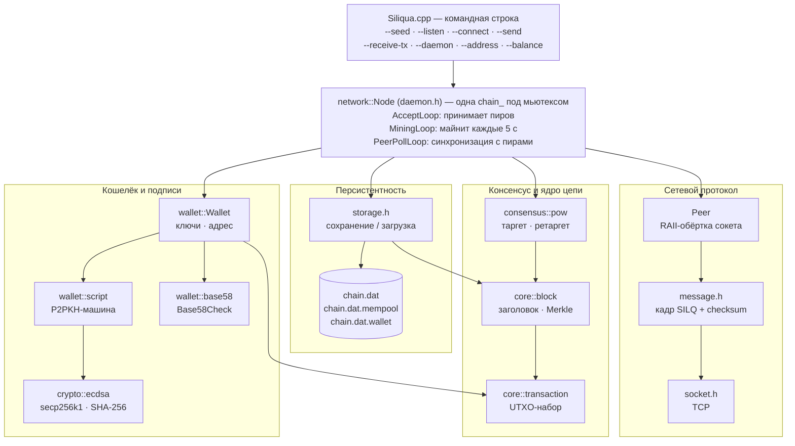
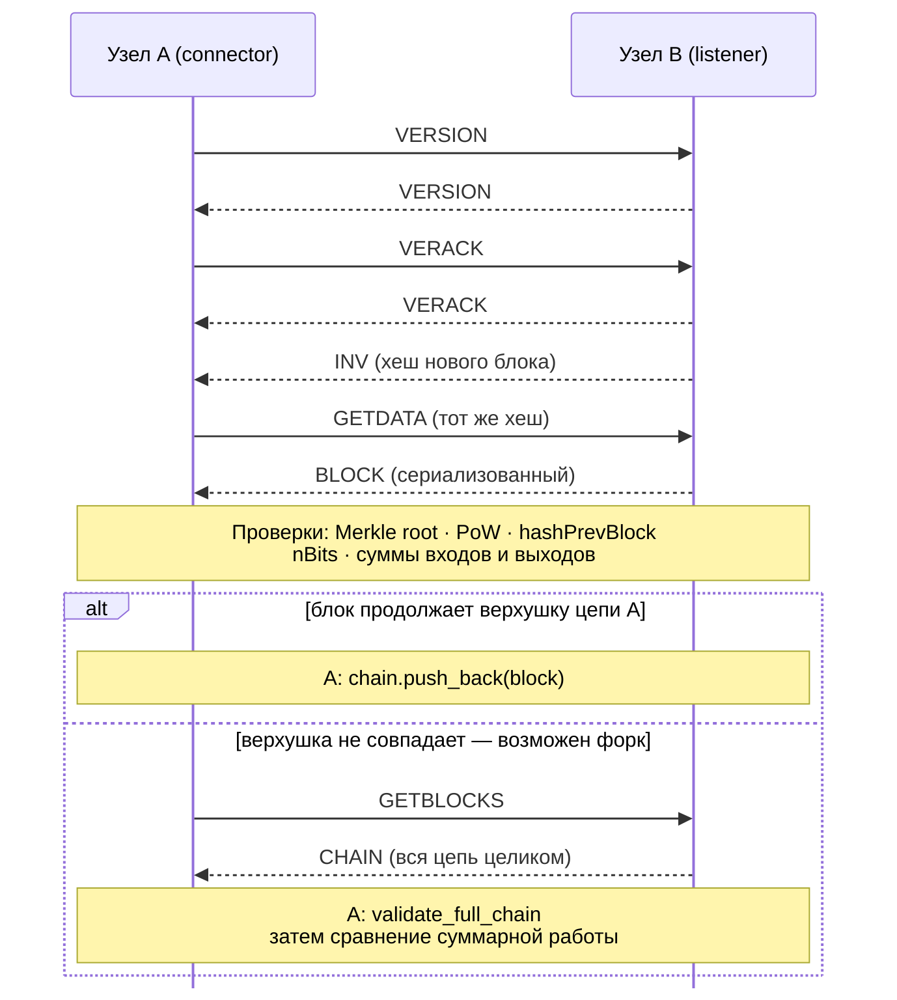

# Блокчейн «Siliqua»

*English version: [ARCHITECTURE.en.md](ARCHITECTURE.en.md) · интерактивная HTML-схема: [architecture.ru.html](https://crypt0xCode.github.io/Siliqua/architecture.ru.html)*

### Криптография и адреса
* Генерация keypair на основе библиотеки secp256k1: seckey/pubkey/сжатый pubkey.<br>
* ECDSA-подпись и верификация подписи.<br>
* SHA-256, double SHA-256, RIPEMD-160 хеширования.<br>
* Base58Check-кодирование адресов (собственный version byte 0x1E).<br>

### Ядро цепи
* Структуры транзакции: COutPoint, CTxIn, CTxOut, Transaction.<br>
* Double SHA-256 хеш транзакции и блока (GetHash).<br>
* Сериализация, десериализация транзакций и блоков в бинарный формат.<br>
* Merkle Root и его проверка (IsMerkleRootValid).<br>
* UTXO-модель (unordered_map<COutPoint, CTxOut>).<br>

### Консенсус и экономика
* Proof-of-Work: конвертация компактного target nBits в 256-битный target.<br>
* Майнинг блока (перебор nNonce, роллинг nTime при переполнении).<br>
* Изменение сложности добычи (аналог правила Bitcoin, клампинг [0.25x, 4x]).<br>
* Расчёт суммарной работы цепи (chain work) для выбора форка.<br>
* Полная валидация цепи с нуля (validate_full_chain).<br>
* Комиссии (fee) как разница между суммой входов и выходов.<br>
* Halving награды за блок (аналог 210 000 блоков Bitcoin в упрощенном виде).<br>

### Скрипты и кошелёк
* P2PKH scriptPubKey, scriptSig (OP_DUP, OP_HASH160, OP_EQUALVERIFY, OP_CHECKSIG).<br>
* Стековая машина выполнения скриптов (script::evaluate).<br>

### Сетевой протокол (P2P)
* Собственный бинарный протокол поверх TCP (magic bytes "SILQ" от Siliqua).<br>
* Кадрирование сообщений: magic + команда + длина + checksum.<br>
* Команды: VERSION, VERACK, INV, GETDATA, BLOCK, TX, GETBLOCKS, CHAIN.<br>
* Кроссплатформенные сокеты (Winsock/POSIX) через единый интерфейс.<br>

### Узел (Node) и демон
* Разовые CLI-операции: run_listener, run_connector, run_send_tx, run_receive_tx.<br>
* Постоянный многопоточный демон (network::Node): AcceptLoop, MiningLoop, PeerPollLoop.<br>
* Mempool с ограничением размера (MAX_MEMPOOL_SIZE).<br>
* Приём и валидация чужих блоков, продолжение цепи (try_extend_chain).<br>
* Разрешение форков по суммарной работе (try_reorg), а не по длине цепи.<br>
* Мультипир-режим демона (список известных пиров, периодическая синхронизация).<br>
* Режим follower `--no-mine`: демон, который синхронизируется и принимает транзакции, но не майнит.<br>

### Хранилище
* Бинарная (де)сериализация всей цепи в файл.<br>
Персистентность:<br>
* UTXO-сета в файл (`save_utxo_set`/`load_utxo_set`; используются только в демонстрационном режиме, узлы пересобирают UTXO-сет из цепи);<br>
* мемпула в файл;<br>
* кошелька (seckey) в файл, восстановление между запусками.<br>

### CLI команды
*В [Главе 11](#глава-11-cli-команды-и-сценарий-из-двух-узлов) представлен пример использования команд.*<br>
✅ `--seed <path>` - единоразово намайнить «пустую» genesis-цепь (только блок 0) и сохранить её в файл. Награда за genesis уходит на нейтральный нулевой адрес, которым никто не владеет, так каждый узел, скопированный этот файл, стартует с одинаковой метки.<br>
✅ `--listen <port> [chain_path]` - смайнить один новый блок поверх своей текущей цепи, затем слушать TCP-порт и обслужить одного подключившегося клиента (пира): провести handshake и отдать ему этот новый блок.<br>
✅ `--connect <host> <port> [chain_path]` - подключиться к пиру (к узлу, запущенному с --listen), забрать у него блок и, если он валиден и продолжает свою цепь, добавить в chain_path. Если блок не продолжает свой тип, узел вместо отказа запросит у пира всю цепь и сравнит суммарную работу (правило разрешения форков).<br>
✅ `--address <chain_path>` - напечатать в консоль Base58Check-адрес кошелька этого узла (загружает или создаёт <chain_path>.wallet).<br>
✅ `--balance <chain_path>` - напечатать список своих не потраченных UTXO и их сумму в сатоши (sats).<br>
✅ `--send <host> <port> <chain_path> <address> <sum>` - собрать и подписать транзакцию, тратящую собственные UTXO узла (плюс фиксированная комиссия DEFAULT_FEE), и отправить её пиру. Пир кладет ее к себе в mempool.<br>
✅ `--receive-tx <port> <chain_path>` - слушать порт, принять от пира ровно одну транзакцию, проверить её подпись, UTXO и, если она валидна, добавить в свой mempool (транзакация будет ждать следующего запуска --listen, чтобы попасть в блок).<br>
✅ `--daemon <port> <chain_path> [host:port ...] [--no-mine]` - запустить постоянно работающий узел (network::Node). В отличие от всех команд выше, он не завершается после одного пира или одной операции. Демон принимает сколько угодно подключений одновременно (отправленные ему транзакции попадают в его mempool), майнит блоки по таймеру (раз в 5 сек) и сам синхронизируется со списком известных пиров, опрашивая их (фактически имеет функционал всех перечисленных выше команд). С флагом `--no-mine` узел работает как *follower*: принимает пиров и транзакции и синхронизируется, но никогда не майнит. В сети должен быть ровно один майнер - два майнящих демона расходятся по разным веткам, а платёж, тратящий монеты из проигравшей ветки, отклоняется.<br>

*Примечания:* вывод spdlog (уровень debug) печатается в консоль вместе с результатом (для `--address` адрес - последняя строка, для `--balance` - строка `N UTXO(s), M satoshi total.`). `--help` (или `-h`) печатает список команд. Неизвестный флаг, неверное число аргументов, а также неверный порт, сумма или адрес получателя приводят к сообщению с пояснением и строкой использования этой команды и к коду выхода 2. Исключение во время работы (например, неудачный `connect()`) выводится как `Error: ...` с кодом выхода 1, а не обрывает процесс аварийно. Демонстрационный режим запускается только при старте вообще без аргументов: он спрашивает строку, печатает её SHA-256 и double SHA-256, генерирует keypair, подпись и адрес, строит примеры транзакций и записывает `utxo.dat` в текущую папку.

### Сборка
* Кроссплатформенный CMake (Windows/Linux/macOS), C++23.<br>
* Поиск secp256k1 и Crypto++ через pkg-config (запасной вариант: find_library/find_path), на Windows они берутся из `Siliqua/libs/`.<br>
* Оптимизация под слабое, старое железо (-O2 вместо -O3).<br>
* Интеграционные тесты-скрипты: `scripts/multi_node_test.sh` (консенсус трёх узлов) и `scripts/fork_test.sh` (разрешение форков по суммарной работе).

---

## Глава 1: Введение

### Название проекта
Siliqua — прототип однорангового (P2P) блокчейна Bitcoin-like, написанный C++ без внешних блокчейн-фреймворков.

### Цель проекта
Воспроизвести ключевые архитектурные и алгоритмические паттерны Bitcoin (UTXO, Proof-of-Work, P2P-протокол, скрипты, halving, комиссии) в компактной, читаемой кодовой базе, оптимизированной для запуска на слабом/старом оборудовании.

### Технологический стек

| Компонент            | Технологии                                                       |
|----------------------|------------------------------------------------------------------|
| Язык                 | C++23                                                            |
| Криптография (ECDSA) | libsecp256k1                                                     |
| Хеширование          | picosha2 (SHA-256), Crypto++ (RIPEMD-160)                        |
| Сеть                 | "сырые" TCP-сокеты (POSIX, Winsock), собственный бинарный протокол |
| Поддержка платформ   | CMake ≥ 3.15, кроссплатформенность (Windows, Linux, macOS)       |
| Хранилище            | "сырые" бинарные файлы (chain.dat, *.wallet, *.mempool)            |

### Основные функции платформы
- Генерация кошелька (keypair secp256k1) и Base58Check-адреса.<br>
- Отправка и приём подписанных транзакций с комиссией.<br>
- Майнинг блоков с Proof-of-Work и наградой за блок (с halving).<br>
- Проверка входящих блоков и транзакций (подписи, UTXO, суммы).<br>
- Разрешение форков по суммарной работе цепи, а не по длине.<br>
- Постоянно работающий узел (демон), синхронизирующийся с несколькими пирами.<br>
- Персистентность цепи, UTXO, mempool'а и кошелька между запусками.

### Пройденные этапы разработки
На основе истории коммитов репозитория:

| Этап                                            | Ключевые результаты |
|-------------------------------------------------| -------------------- |
| Инициализация проекта, кроссплатформенный CMake | Windows, Linux, macOS сборка |
| Криптографический слой                          | ECDSA (seckey, pubkey, подпись, верификация), генерация адреса |
| Ядро: транзакции и блоки                        | COutPoint, CTxIn, CTxOut, CBlockHeader, CBlock, Merkle Root |
| Consensus: Proof-of-Work                        | compact target ↔ 256-бит, майнинг, проверка PoW |
| Персистентность                                 | сериализация, десериализация цепи и UTXO в файлы |
| P2P-протокол                                    | сообщения, рукопожатие VERSION, VERACK, сокеты |
| Первый обмен блоками между узлами               | Listener, Connector, генератор тестовых транзакций |
| Кошельки и подписи                              | класс Wallet, генератор уникальных кошельков, отдельные UTXO по адресам |
| Экономика сети                                  | комиссии, halving, лимит мемпула |
| Реальные скрипты Bitcoin                        | scriptPubKey, scriptSig, стековая машина P2PKH |
| Мультипир демон                                 | многопоточный Node (Accept, Mining, PeerPoll), Base58-адреса |

---

## Глава 2: Архитектурная схема
### Компоненты системы
- **CLI (`Siliqua.cpp`):** разбор флагов запуска, диспетчеризация на разовые операции или демон.<br>
- **`network::Node` (демон, `daemon.h`):** приём пиров, майнинг по таймеру, опрос известных пиров, общая цепь под `std::mutex`.<br>
- **Consensus (`consensus/pow.h`):** конвертация target, майнинг, изменение сложности майнинга, суммарная работа цепи.<br>
- **Core (`core/block.h`, `core/transaction.h`):** структуры блока и транзакции, Merkle Root, UTXO-сет.<br>
- **Wallet (`wallet/*.h`):** ключи, адреса (Base58Check), сборка и подпись транзакций, P2PKH-скрипты.<br>
- **Crypto (`crypto/ecdsa.h`):** обёртка над secp256k1 и хеш-функциями.<br>
- **Network (`network/*.h`):** кадрирование сообщений, TCP-сокеты (POSIX, Windows).<br>
- **Storage (`storage/storage.h`):** бинарная персистентность цепи, UTXO, mempool'a, кошелька в файлы.<br>

### Граф зависимостей и потоков управления

**Легенда:** стрелка `A --> B` означает «A использует B» (в коде это `#include` и вызовы, сверено по заголовкам); прямоугольник - модуль или класс; цилиндр - файл на диске. Консенсус и ядро цепи не используют ни одну из других групп.

### Handshake и обмен блоком между двумя узлами
Тот же цикл запросов, что использует `run_connector`: если полученный блок не продолжает собственную верхушку цепи, узел не отбрасывает его сразу — запрашивает всю цепь пира и сравнивает суммарную работу (правило Bitcoin: побеждает не самая длинная цепь, а цепь с наибольшей работой).

Полная таблица экономических констант, показанных на диаграммах, находится в [Главе 10](#глава-10-экономика-и-лимиты-сети).

---

## Глава 3: Криптография и адреса
*Фрагменты кода в Главах 3-9 сокращены (сигнатуры без тел, часть скобок и комментариев опущена); полный код - в `Siliqua/include/`.*

### Хеш-функции и подпись (`crypto/ecdsa.h`)
```cpp
namespace crypto {
    inline void hash_sha256(const std::vector<uint8_t>& input, std::array<uint8_t, 32>& output);
    inline void hash_double_sha256(const std::vector<uint8_t>& input, std::array<uint8_t, 32>& output);
    inline void hash_ripemd160(unsigned char* ripemd160_hash, unsigned char* input, size_t len);

    int generate_keypair(std::string input, std::vector<std::string>& keypair,
        unsigned char* seckey, secp256k1_pubkey& pubkey, unsigned char* compressed_pubkey);
    int create_address_from_pubkey(unsigned char* compressed_pubkey,
        unsigned char* ripemd160_hash, std::string& ripemd160_hash_string);
    int generate_sign(std::string input, unsigned char* seckey,
        unsigned char* serialized_signature, std::string& str_signature,
        secp256k1_ecdsa_signature& sig, unsigned char* input_hash);
    int verify_sign(secp256k1_ecdsa_signature& sig, unsigned char* serialized_signature,
        secp256k1_pubkey& pubkey, unsigned char* compressed_pubkey, unsigned char* input_hash);
}
```
Адрес = `RIPEMD160(SHA256(compressed_pubkey))`, 20 байт (`wallet::ADDRESS_SIZE`).

### Base58Check-адреса (`wallet/base58.h`)
Тот же алгоритм, что и в реальном Bitcoin: алфавит без похожих символов (0/O, I/l) + контрольная сумма для защиты от опечаток. Собственный version byte, чтобы адрес Siliqua никогда не спутать с настоящим Bitcoin-адресом:
```cpp
constexpr uint8_t ADDRESS_VERSION_BYTE = 0x1E;

inline std::string encode_address(const std::array<uint8_t, ADDRESS_SIZE>& address) {
    std::vector<uint8_t> payload;
    payload.push_back(ADDRESS_VERSION_BYTE);
    payload.insert(payload.end(), address.begin(), address.end());

    std::array<uint8_t, 32> checksum{};
    crypto::hash_double_sha256(payload, checksum);
    payload.insert(payload.end(), checksum.begin(), checksum.begin() + 4);

    return base58_encode(payload);
}
```
`decode_address()` - обратная операция с проверкой версии и контрольной суммы (бросает исключение при опечатке).

### Подпись сообщений (`wallet/signing.h`)
```cpp
constexpr size_t SIGNATURE_SIZE = 64; // secp256k1 compact signature
constexpr size_t PUBKEY_SIZE = 33;    // сжатый pubkey

std::vector<uint8_t> sign_raw(const unsigned char seckey[32], const std::array<uint8_t, 32>& sighash);
bool verify_raw_signature(const std::vector<uint8_t>& sig_bytes,
    const std::vector<uint8_t>& pubkey_bytes, const std::array<uint8_t, 32>& sighash);
```
Подписывается хеш транзакции, посчитанный **при всех пустых `scriptSig`** (аналог `SIGHASH_ALL` в Bitcoin; подпись не может зависеть от собственных байт).

---

## Глава 4: Транзакции и UTXO-модель
### Структуры (`core/transaction.h`)
| Структура     | Поля                                               | Назначение                               |
| ------------- | ---------------------------------------------------- |------------------------------------------|
| `COutPoint`   | `txid[32]`, `n`                                       | указатель на конкретный выход прошлой tx |
| `CTxIn`       | `prevout`, `scriptSig`, `nSequence`                   | вход (тратит один UTXO)                  |
| `CTxOut`      | `nValue` (сатоши), `scriptPubKey`                     | выход (новый неподтверждённый остаток)   |
| `Transaction` | `nVersion`, `vin`, `vout`, `nLockTime`, `tx_hash`     | вся транзакция                           |

### Хеш и Coinbase
```cpp
std::array<uint8_t, 32> Transaction::GetHash() const;  // двойной SHA-256 сериализованной tx
bool Transaction::IsCoinbase() const;                  // проверка на coinbase (первую транзакцию в блоке, которая дает награду майнеру)
```

### Построение UTXO-сета из всей цепи (`network/node.h`)
```cpp
inline transaction::UtxoSet build_utxo_set(const std::vector<block::CBlock>& chain) {
    transaction::UtxoSet utxos;
    for (const auto& blk : chain)
        for (const auto& tx : blk.vtx)
            for (uint32_t i = 0; i < tx.vout.size(); ++i)
                utxos.emplace(transaction::COutPoint(tx.tx_hash, i), tx.vout.at(i));
    for (const auto& blk : chain)
        for (const auto& tx : blk.vtx)
            for (const auto& in : tx.vin)
                utxos.erase(in.prevout);
    return utxos;
}
```

### Проверка транзакции и вычисление комиссии
```cpp
// fee (>= 0), если tx валидна; -1, если нет.
inline int64_t validate_and_get_fee(const transaction::Transaction& tx, const transaction::UtxoSet& utxo_set) {
    if (tx.vin.empty()) return -1;
    int64_t input_total = 0;
    for (size_t i = 0; i < tx.vin.size(); ++i) {
        auto it = utxo_set.find(tx.vin.at(i).prevout);
        if (it == utxo_set.end() || !wallet::verify_transaction_signature(tx, i, it->second.scriptPubKey))
            return -1;
        input_total += it->second.nValue;
    }
    int64_t output_total = 0;
    for (const auto& out : tx.vout) output_total += out.nValue;
    if (output_total > input_total) return -1;
    return input_total - output_total; // разница = комиссия
}
```

---

## Глава 5: Блоки и Proof-of-Work
### Заголовок блока (`core/block.h`)
```cpp
struct CBlockHeader {
    int32_t nVersion;
    std::array<uint8_t, 32> hashPrevBlock;
    std::array<uint8_t, 32> hashMerkleRoot;
    uint32_t nTime;
    uint32_t nBits;   // компактный target
    uint32_t nNonce;

    std::array<uint8_t, 32> GetHash() const;
};

class CBlock : public CBlockHeader {
public:
    std::vector<transaction::Transaction> vtx;
    std::array<uint8_t, 32> BuildMerkleRoot() const;
    bool IsMerkleRootValid() const;
    bool IsValid() const;
};
```

### Compact target => 256 бит (`consensus/pow.h`)
Верхний байт `nBits` - экспонента (длина в байтах), младшие 3 байта - мантисса, как и в Bitcoin:
```cpp
inline std::array<uint8_t, 32> bits_to_target(uint32_t bits);
inline bool check_proof_of_work(const block::CBlockHeader& header); // hash <= target
inline void mine_block(block::CBlockHeader& header, uint32_t nBitsTarget); // перебор nNonce
```

### Ретаргет сложности
```cpp
constexpr uint32_t RETARGET_INTERVAL = 5;         // блоков между пересчётами
constexpr uint32_t TARGET_TIMESPAN_SECONDS = 60;  // ожидаемое время на интервал
constexpr uint32_t INITIAL_BITS = 0x207fffff;

// actual_timespan клампится в [target/4, target*4] — всплеск быстрых/медленных блоков не может сдвинуть сложность больше чем в 4 раза за один ретаргет.
uint32_t get_next_work_required(const std::vector<block::CBlockHeader>& headers,
    uint32_t retarget_interval, uint32_t target_timespan_seconds);
```

### Выбор форка — по суммарной работе, а не по длине
```cpp
double calculate_block_work(uint32_t nBits);              // 2^256 / target
double calculate_chain_work(const std::vector<block::CBlockHeader>& headers);
```
Ключевое правило Bitcoin, воспроизведённое здесь: побеждает цепь с наибольшей **суммарной работой** (`try_reorg` в `node.h`), а не просто более длинная. Обычно это совпадает, но не всегда.

### Награда за блок и halving (`network/node.h`)
```cpp
constexpr int64_t INITIAL_REWARD = 5000000000; // 50 монет, блок 0
constexpr uint32_t HALVING_INTERVAL = 10;      // блоков на halving (для наглядности теста)

inline int64_t calculate_block_reward(uint32_t height) {
    uint32_t halvings = height / HALVING_INTERVAL;
    if (halvings >= 63) return 0;
    return INITIAL_REWARD >> halvings;
}
```
Coinbase-вход кодирует высоту блока в `scriptSig` (аналог Bitcoin BIP34) — иначе два блока с одинаковой наградой от одного адреса дали бы идентичный `tx_hash` и столкнулись бы в UTXO-сете.

---

## Глава 6: Скрипты P2PKH

### Опкоды (`wallet/script.h`)

| Опкод            | Код    | Действие                                                    |
| ----------------- | ------ | -------------------------------------------------------------- |
| `OP_DUP`          | `0x76` | дублирует верх стека                                          |
| `OP_HASH160`      | `0xa9` | `RIPEMD160(SHA256(x))` верха стека                             |
| `OP_EQUALVERIFY`  | `0x88` | сравнивает два верхних элемента, обрывает при несовпадении     |
| `OP_CHECKSIG`     | `0xac` | проверяет подпись против sighash                                |

### Построение скриптов
```cpp
// OP_DUP OP_HASH160 <push 20-byte address> OP_EQUALVERIFY OP_CHECKSIG
std::vector<uint8_t> build_p2pkh_script_pubkey(const std::array<uint8_t, wallet::ADDRESS_SIZE>& address);

// <push signature><push pubkey>
std::vector<uint8_t> build_script_sig(const std::vector<uint8_t>& signature, const std::vector<uint8_t>& pubkey);
```

### Выполнение (стековая машина)
`scriptSig` и `scriptPubKey` конкатенируются и выполняются как одна программа, как в настоящем Bitcoin. Трата валидна, если на стеке в конце остаётся ровно одно истинное значение:
```cpp
bool evaluate(const std::vector<uint8_t>& script_sig,
    const std::vector<uint8_t>& script_pubkey, const std::array<uint8_t, 32>& sighash);
```
Это не полный Bitcoin Script (~100 опкодов), а минимум, необходимый для классического P2PKH.

---

## Глава 7: Сетевой протокол (P2P)
### Формат кадра сообщения (`network/message.h`)
| Поле       | Размер     | Описание                                          |
| ----------- | ---------- | ------------------------------------------------------ |
| magic       | 4 байта    | `"SILQ"` — не спутать с реальным Bitcoin-трафиком      |
| command     | 12 байт    | имя команды, дополненное нулями                        |
| length      | 4 байта LE | длина payload                                           |
| checksum    | 4 байта    | первые 4 байта double-SHA256(payload)                   |
| payload     | переменная | тело сообщения                                          |

```cpp
inline constexpr std::array<uint8_t, 4> MAGIC_BYTES = { 'S', 'I', 'L', 'Q' };
inline constexpr uint32_t MAX_PAYLOAD_SIZE = 4 * 1024 * 1024; // защита от враждебного length
```

### Команды протокола
| Команда      | Направление                        | Назначение                                     |
| ------------- | ------------------------------------ | ------------------------------------------------- |
| `version`     | инициатор => получатель               | согласование версии протокола                     |
| `verack`      | получатель => инициатор               | подтверждение рукопожатия                          |
| `inv`         | listener => connector                 | анонс хеша нового блока                            |
| `getdata`     | connector => listener                 | запрос блока по хешу                               |
| `block`       | listener => connector                 | сериализованный блок                               |
| `tx`          | отправитель => получатель             | подписанная транзакция для мемпула                 |
| `getblocks`   | connector => listener                 | запрос всей цепи (для разрешения форка)            |
| `chain`       | listener => connector                 | вся цепь целиком (`storage::serialize_chain`)      |

### Класс Peer — RAII-обёртка сокета (`network/peer.h`)
```cpp
class Peer {
public:
    explicit Peer(socket_t sock) : sock_(sock) {}
    ~Peer() { close_socket(sock_); }
    Peer(const Peer&) = delete; // у сокета ровно один владелец

    bool Send(const std::string& cmd, const std::vector<uint8_t>& payload) const;
    bool Receive(Message& out) const;
};
```

---

## Глава 8: Узел — CLI-режимы и постоянный демон
### Разовые операции (`network/node.h`)
Каждая функция выполняет ровно один обмен с ровно одним пиром и завершается:

| Функция              | Что делает                                                                                                                  |
| ---------------------- |-----------------------------------------------------------------------------------------------------------------------------|
| `run_listener`         | добывает новый блок поверх своей цепи, слушает порт, обслуживает одного пира                                                |
| `run_connector`        | подключается к пиру, забирает блок; если он не продолжает свой тип, запрашивает всю цепь пира и сравнивает суммарную работу |
| `run_send_tx`          | собирает и подписывает транзакцию из своих UTXO, отправляет пиру в мемпул                                                   |
| `run_receive_tx`       | принимает одну транзакцию, проверяет подпись/UTXO, кладёт в мемпул                                                          |

### Постоянный демон `network::Node` (`network/daemon.h`)
```cpp
class Node {
public:
    Node(uint16_t listen_port, const std::string& chain_path, std::vector<PeerAddress> known_peers, bool mine = true);
    [[noreturn]] void Run(); // запускает 3 потока (2, если mine == false) и никогда не возвращает управление

private:
    [[noreturn]] void AcceptLoop();    // принимает пиров, каждого — в отдельном detached-потоке
    void HandleConnection(socket_t client_sock);
    void AcceptTransaction(const transaction::Transaction& tx, const std::string& prefix);
    [[noreturn]] void MiningLoop();    // раз в DAEMON_CYCLE_SECONDS добывает блок из мемпула
    [[noreturn]] void PeerPollLoop();  // раз в DAEMON_CYCLE_SECONDS опрашивает known_peers_
    void PollPeer(const PeerAddress& addr);

    std::mutex mutex_;                 // защищает chain_ от гонок между тремя циклами
    std::vector<block::CBlock> chain_;
    bool mine_;                        // false = --no-mine: поток MiningLoop не запускается
};
```

С `--no-mine` (`mine == false`) `Run()` пропускает MiningLoop: узел по-прежнему принимает пиров, складывает их транзакции в mempool и опрашивает `known_peers_`, но принимает только блоки, добытые кем-то другим. Демон блоки *забирает* (PeerPollLoop спрашивает у каждого известного пира его верхушку и, если она не продолжает нашу цепь, всю цепь целиком); присланный ему `BLOCK` не принимается, поэтому новый блок появляется у follower в течение одного цикла (около 5 с).

### Приём блока и разрешение форка
```cpp
bool try_extend_chain(std::vector<block::CBlock>& chain, const block::CBlock& received_block);
bool try_reorg(std::vector<block::CBlock>& chain, const std::vector<block::CBlock>& peer_chain);
bool validate_full_chain(const std::vector<block::CBlock>& chain); // с нуля, от genesis
```
Полная последовательность обмена показана на диаграмме в [Главе 2](#глава-2-архитектурная-схема) (handshake и обмен блоком).

---

## Глава 9: Хранилище (`storage/storage.h`)

| Файл                   | Формат                                                                       |
|------------------------| --------------------------------------------------------------------------- |
| `<chain_path>`         | количество блоков (varint) + `Serialize()` каждого блока подряд             |
| `<chain_path>.wallet`  | 32 сырых байта seckey                                                       |
| `<chain_path>.mempool` | количество tx (varint) + `Serialize()` каждой транзакции подряд             |
| `<any>.utxo`           | количество записей (varint) + пары `COutPoint::Serialize()`+`CTxOut::Serialize()` |

Файл `.utxo` пишет только демонстрационный режим (`utxo.dat`); `--listen`, `--connect`, `--daemon` и остальные режимы пересобирают UTXO-сет из цепи.

```cpp
void save_chain(const std::vector<block::CBlock>& chain, const std::string& path);
std::vector<block::CBlock> load_chain(const std::string& path);
void save_mempool(const std::vector<transaction::Transaction>& mempool, const std::string& path);
std::vector<transaction::Transaction> load_mempool(const std::string& path);
```

---

## Глава 10: Экономика и лимиты сети

| Константа                  | Значение          | Смысл                                                     | Файл                  |
| ---------------------------- | ------------------ | ------------------------------------------------------------ | ----------------------- |
| `INITIAL_REWARD`             | 5 000 000 000      | 50 монет — награда за блок 0, до halving                     | `network/node.h`        |
| `HALVING_INTERVAL`           | 10 блоков          | награда делится пополам каждые N блоков                      | `network/node.h`        |
| `DEFAULT_FEE`                | 1000 сатоши        | фиксированная комиссия `run_send_tx`                          | `network/node.h`        |
| `RETARGET_INTERVAL`          | 5 блоков           | как часто пересчитывается сложность                          | `network/node.h`        |
| `TARGET_TIMESPAN_SECONDS`    | 60 с               | ожидаемое время на `RETARGET_INTERVAL` блоков                 | `network/node.h`        |
| `MAX_MEMPOOL_SIZE`           | 1000 tx            | потолок неподтверждённых транзакций                           | `network/node.h`        |
| `DUST_THRESHOLD`             | 1000 сатоши        | сдача меньше этого не выделяется в отдельный UTXO             | `wallet/wallet.h`       |
| `DAEMON_CYCLE_SECONDS`       | 5 с                | период циклов MiningLoop и PeerPollLoop                       | `network/daemon.h`      |
| `ADDRESS_VERSION_BYTE`       | `0x1E`             | собственный префикс адреса (не Bitcoin mainnet)               | `wallet/base58.h`       |
| `MAGIC_BYTES`                | `"SILQ"`           | отличает трафик Siliqua от настоящего Bitcoin P2P              | `network/message.h`     |

Значения намеренно небольшие (halving за 10 блоков, ретаргет за 5): поведение можно наблюдать за один тестовый прогон, а не за годы, как в реальном Bitcoin.

---

## Глава 11: CLI, команды и сценарий из двух узлов
### Справка по флагам (`src/Siliqua.cpp`) указана в разделе [CLI](#cli-команды).
### Практический сценарий: два узла, один перевод
```bash
# 1. Узел A сеет genesis-цепь.
./Siliqua --seed nodeA.dat

# 2. Узел B копирует тот же genesis до того, как A замайнит следующий блок:
#    run_connector требует уже существующую цепь с общим genesis, иначе
#    первый же полученный блок не свяжется по hashPrevBlock и будет отклонён.
cp nodeA.dat nodeB.dat

# 3. Узел A добывает блок 1 поверх своей цепи и слушает порт 9000.
./Siliqua --listen 9000 nodeA.dat &

# 4. Узел B подключается, забирает блок 1 и дописывает его в свою копию цепи.
./Siliqua --connect 127.0.0.1 9000 nodeB.dat

# 5. Смотрим адреса и баланс узла A (награда за блок 1 ушла на его кошелёк).
./Siliqua --address nodeA.dat
./Siliqua --address nodeB.dat
./Siliqua --balance nodeA.dat

# 6. Узел B слушает порт для приёма транзакции.
./Siliqua --receive-tx 9001 nodeB.dat &

# 7. Узел A отправляет часть своего баланса на адрес узла B (адрес из шага 5).
./Siliqua --send 127.0.0.1 9001 nodeA.dat <адрес_узла_B> 100000

# 8. Постоянный демон вместо разовых команд. 127.0.0.1:9001 - пример пира:
#    --receive-tx из шага 6 уже завершился, поэтому запустите там узел или не указывайте пира.
#    Несколько машин: см. сценарий «хаб + follower» ниже (--no-mine).
./Siliqua --daemon 9000 nodeA.dat 127.0.0.1:9001
```

### Практический сценарий: два компьютера через один порт (хаб + follower)
Хаб (например, ПК с Windows и публичным IP, ниже `HUB_IP`) запускает единственного майнера; follower (например, Mac) синхронизируется с ним и сам не майнит. **Входящий порт нужен только хабу** (здесь TCP 9000) - follower только подключается наружу.

Что сделать на хабе перед началом:
* разрешить входящий TCP 9000 в фаерволе для *активного* сетевого профиля (Private/Public) и пробросить TCP 9000 на роутере на LAN-адрес хаба; на Windows `libsecp256k1-6.dll` должна лежать рядом с `Siliqua.exe`;
* запустить демон (шаг 3 ниже) и проверить с follower: `nc -vz -G 5 HUB_IP 9000`. `succeeded` - порт доступен; `Connection refused` - пакет дошёл, но порт никто не слушает; `Operation timed out` - пакет отбрасывает фаервол, роутер или провайдер (CGNAT).

```bash
# 1. Хаб: сеет общий genesis, затем копирует на follower ТОЛЬКО chain.dat
#    (файлы *.wallet не копировать никогда - у каждого узла свои ключи). На Windows: .\Siliqua.exe.
./Siliqua --seed chain.dat

# 2. Обе машины: вывести адрес кошелька (последняя строка вывода).
./Siliqua --address chain.dat

# 3. Хаб, терминал 1: запустить майнера и оставить работать.
./Siliqua --daemon 9000 chain.dat

# 4. Follower, терминал 1: запустить немайнящий узел, синхронизирующийся с хабом.
./Siliqua --daemon 9000 chain.dat HUB_IP:9000 --no-mine

# 5. Хаб, терминал 2 (через ~10 с, когда добыты первые блоки): заплатить follower 10 монет.
#    Суммы в сатоши; комиссия 1000 добавляется автоматически.
./Siliqua --send 127.0.0.1 9000 chain.dat FOLLOWER_ADDRESS 1000000000

# 6. Follower, терминал 2 (через ~10 с: хаб майнит платёж, follower забирает блок).
./Siliqua --balance chain.dat

# 7. Follower, терминал 2: заплатить хабу в ответ; демон follower продолжает работать.
./Siliqua --send HUB_IP 9000 chain.dat HUB_ADDRESS 300000000

# 8. Обе машины через ~10 с: проверить балансы.
./Siliqua --balance chain.dat
```
У follower в конце будет `699999000` сатоши (1000000000 - 300000000 - 1000 комиссии). Баланс хаба - его награды за добытые блоки минус 1000000000 плюс 300000000 плюс 1000 комиссии, собранной как майнером. Демоны останавливаются через `Ctrl+C`. `scripts/daemon_hub_test.sh` прогоняет именно этот сценарий с двумя демонами на одной машине и проверяет эти числа.

### Тот же сценарий без демонов (один слушатель за раз)
Если хочется пройти каждый раунд вручную, порт 9000 слушает только хаб и только одна команда за раз:
1. Хаб: `--listen 9000 chain.dat` (майнит блок), затем follower: `--connect HUB_IP 9000 chain.dat`.
2. Платёж хаб -> follower: на хабе в терминале 1 `--receive-tx 9000 chain.dat`, в терминале 2 `--send 127.0.0.1 9000 chain.dat FOLLOWER_ADDRESS 1000000000`; затем снова `--listen 9000 chain.dat` на хабе и `--connect HUB_IP 9000 chain.dat` на follower.
3. Платёж follower -> хаб: хаб `--receive-tx 9000 chain.dat`, follower `--send HUB_IP 9000 chain.dat HUB_ADDRESS 300000000`; затем ещё раз `--listen` на хабе и `--connect` на follower.

Подводные камни этого варианта:
* `--receive-tx` принимает транзакцию, `--listen` - нет: `tx`, присланная узлу в режиме `--listen`, отбрасывается с `Unexpected command 'tx'`, а этот узел уже успел замайнить и сохранить блок, то есть хаб оказывается на блок впереди follower.
* После каждого `--listen` follower обязан выполнить `--connect`: он забирает ровно один блок, а блок, не связанный с его верхушкой, отклоняется. Если раунд пропущен, заново скопируйте `chain.dat` с хаба (`.wallet` follower отдельный и остаётся нетронутым).

---

## Глава 12: Сборка проекта

### Зависимости
Код использует `<print>` / `std::println` (C++23), поэтому стандартная библиотека компилятора должна их поддерживать: проверено на Apple clang 17 и 21; для GCC нужна версия 14 или новее (в GCC 13 нет `<print>`).

#### Linux (Debian):
```bash
sudo apt update
sudo apt install cmake
sudo apt install g++-14 gcc-14

cmake --version
g++-14 --version

sudo apt install libsecp256k1-dev
sudo apt install libcrypto++-dev
```
Если libsecp256k1-dev не найдется в репозитории дистрибутива, то собрать вручную:
```bash
git clone https://github.com/bitcoin-core/secp256k1.git
cd secp256k1 && ./autogen.sh && ./configure && make -j$(nproc) && sudo make install
```

#### macOS:
```zsh
xcode-select --install
brew install cmake

cmake --version
clang++ --version

brew install secp256k1
brew install cryptopp
```
#### Windows:
`libsecp256k1.lib` и `cryptlib.lib` в `Siliqua/libs/` хранятся в Git LFS, поэтому Git LFS обязателен (`libsecp256k1-6.dll` - обычный файл):
```powershell
winget install GitHub.GitLFS
git lfs install
git lfs pull
```
Затем установить MS Visual Studio 2022 с компонентом разработки на C++ под десктопы или MSYS2:
```powershell
winget install MSYS2.MSYS2
# далее в терминале MSYS2 UCRT64:
pacman -S mingw-w64-ucrt-x86_64-gcc mingw-w64-ucrt-x86_64-cmake
```

### Сборка
#### Linux (Debian):
```bash
mkdir -p build && cd build
cmake -DCMAKE_CXX_COMPILER=g++-14 -DCMAKE_BUILD_TYPE=Release ..
cmake --build . --config Release -j$(nproc)

# Собранный бинарник лежит в Siliqua/bin/Siliqua
```
#### macOS:
```zsh
mkdir -p build && cd build
cmake -DCMAKE_BUILD_TYPE=Release ..
cmake --build . --config Release -j$(sysctl -n hw.ncpu)

# Собранный бинарник лежит в Siliqua/bin/Siliqua
```
#### Windows:
*`libsecp256k1-6.dll` должна лежать в той же папке, что и `Siliqua.exe`: Windows не ищет её в `Siliqua/libs/`. Сборка CMake копирует её туда автоматически после линковки; если вы запускаете старую сборку или перенесли exe, скопируйте DLL рядом с ним вручную.*
```powershell
mkdir build; cd build
cmake -DCMAKE_BUILD_TYPE=Release ..
cmake --build . --config Release

# Собранный бинарник лежит в Siliqua\bin\Siliqua.exe или Siliqua\bin\Release\Siliqua.exe
```

### Особенности CMakeLists.txt
Однопроходные генераторы (Make/Ninja) по умолчанию не оптимизируют, если  не указан build type явно - форсируем Release, чтобы `cmake .. && cmake --build .` сразу давал оптимизированный бинарник.
```cmake
set(CMAKE_CXX_STANDARD 23)
set(CMAKE_CXX_STANDARD_REQUIRED ON)

if(NOT CMAKE_BUILD_TYPE AND NOT CMAKE_CONFIGURATION_TYPES)
    set(CMAKE_BUILD_TYPE Release CACHE STRING "Build type" FORCE)
endif()
```
`-O2` вместо `-O3` на GCC/Clang в Release сознательный выбор ради совместимости со слабым или старым железом (без автовекторизации под инструкции, которых может не быть на целевом CPU).

### Threads
`network/daemon.h` использует `std::thread`; на Linux это требует `-lpthread`, что решается через `Threads::Threads` вместо ручного флага, специфичного для платформы.

### Тесты
Скриптам из `Siliqua/scripts/` нужен собранный `bin/Siliqua`; запускать из папки `Siliqua/`. Рабочие файлы кладутся в `/tmp/siliqua_*` или в папку из первого аргумента:
```bash
cd Siliqua
./scripts/multi_node_test.sh   # A майнит, A платит B, B майнит платёж, C синхронизируется; цепи B и C должны совпасть побайтно
./scripts/fork_test.sh         # E переходит на более тяжёлую ветку и не возвращается на более лёгкую
./scripts/daemon_hub_test.sh  # хаб (майнящий демон) + follower (демон --no-mine): два платежа в обе стороны, точные балансы, follower ничего не майнит
```
Успешный прогон завершается кодом 0 и печатает строки `OK: ...`. Скрипты считают блоки с единицы (genesis - это #1), поэтому «block #2» в их выводе - это «блок 1» из [Главы 11](#глава-11-cli-команды-и-сценарий-из-двух-узлов).
